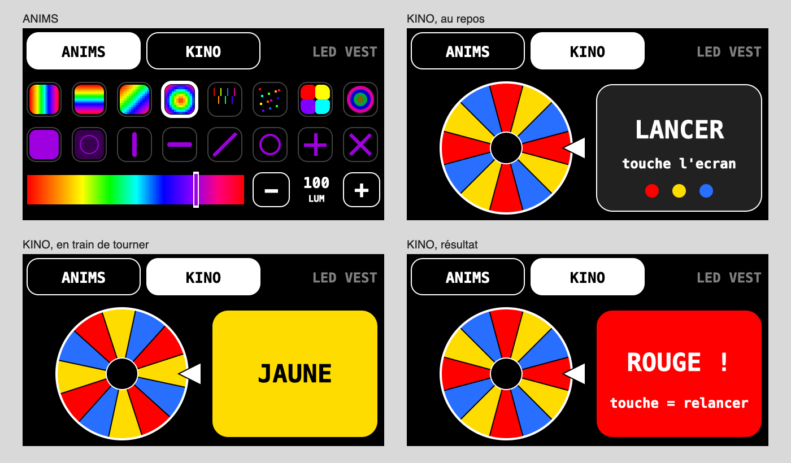

# Commander-Kino

Télécommande tactile LilyGo T-Display S3 pour les manteaux LED, version Kino. Elle pilote la veste proto 2 (style veste de baseball) et le manteau V1 (proto 1).



*Aperçu dessiné à partir des coordonnées du code. Les polices de la LilyGo sont un peu différentes.*

## Les deux écrans

### ANIMS

Les animations habituelles de la veste :
- **Ligne 1** : les arcs-en-ciel et les animations multicolores (vertical, horizontal, diagonal, circulaire, pluie, étincelles, fondu, pulsation).
- **Ligne 2** : les animations d'une seule teinte (plein, pulsation, lignes, cercle, croix).
- **Ligne 3** : la barre de couleur règle la teinte de la ligne 2. Les boutons `-` et `+` règlent la luminosité, de 10 à 150 au maximum : au-delà, surtout en blanc, le BMS de la batterie coupe le manteau. La veste proto 2 démarre à 100. Sur le manteau V1, c'est la molette qui règle la luminosité, jusqu'au premier appui sur `-` ou `+` : ensuite, c'est la télécommande, jusqu'au redémarrage du manteau.

Les animations GIF du firmware (16 à 21) ne sont pas codées dans la veste proto 2 : elles ne sont pas proposées.

### KINO

La roulette de la super contrainte. Touche l'écran n'importe où sous les onglets :
1. La roue tourne, vite puis de plus en plus lentement, pendant environ 5,5 s.
2. Elle s'arrête sur **rouge**, **jaune** ou **bleu**.
3. La couleur clignote 4 fois, puis reste affichée.

La veste fait exactement la même chose au même moment. Un nouvel appui pendant que la roue tourne ne fait rien. Une fois le résultat affiché, un nouvel appui relance un tirage. Pour revenir aux animations, va dans ANIMS et touche une animation.

Chaque couleur a une chance sur trois. Le tirage vient du générateur matériel de l'ESP32, et le nombre de pas est toujours le même.

Les deux boutons physiques règlent la luminosité de l'écran de la télécommande, comme avant.

## Comment la veste suit la roue

C'est la télécommande qui tire la couleur de départ. Elle l'envoie à la veste en ESP-NOW, sur le canal 3, en diffusion. Les deux déroulent ensuite la même séquence, avec les mêmes réglages : 26 pas, de 50 ms à 542 ms, puis 0,65 s d'arrêt et 4 clignotements de 230 ms.

Le message est envoyé 4 fois, à 60 ms d'intervalle, parce que la veste partage sa radio avec le Bluetooth de l'appli et peut en rater un. La valeur du message dit de quelle répétition il s'agit : si la veste rate les premières, elle sait de combien elle est en retard et se recale sur l'écran.

| Message ESP-NOW | Type | Valeur |
|---|---|---|
| Luminosité | `0` | 0 à 255 |
| Ignorer la molette (manteau V1) | `5` | `1` |
| Teinte | `1` | 0 à 255 (0 rouge, 64 jaune, 160 bleu) |
| Animation | `3` | numéro d'animation |
| Roulette | `11` | couleur de départ (0 rouge, 1 jaune, 2 bleu) + 3 × numéro de répétition (0 à 3) |

La logique de la roulette (`CommanderKino/RouletteLogic.h`) est une copie exacte de celle des manteaux. Si tu changes un réglage, change-le partout, puis lance :

```bash
test/check_sync.sh "/Users/guillaumelotis/Documents/Code/Arduino/Led Coat"
```

```bash
test/check_sync.sh ~/Documents/Code/Arduino/LedVestProto1
```

## Il faut aussi flasher le manteau

Le manteau doit connaître le message de roulette `11`. Les deux firmwares sont sur la branche `feat/roulette-kino` :
- **Veste proto 2** : **LedVestProto2**. Ce firmware écoute l'ESP-NOW en plus du Bluetooth. Dans Arduino IDE, choisis **Outils > Partition Scheme > Minimal SPIFFS (1.9MB APP with OTA/190KB SPIFFS)**. Le mode d'emploi complet est dans `LedCoatAnim/ROULETTE.md`, dans ce dépôt.
- **Manteau V1** : **LedVestProto1**. Il écoutait déjà l'ESP-NOW ; la roulette remplit ses 4 bandes, à la luminosité de la molette.

## Flasher la télécommande

- Arduino IDE, cœur **esp32 2.0.x** (compilé avec la 2.0.16), carte **ESP32S3 Dev Module**.
- Bibliothèques :
  - **TFT_eSPI**, avec `#include <User_Setups/Setup206_LilyGo_T_Display_S3.h>` activé dans `User_Setup_Select.h` ;
  - **TouchLib** de LilyGo, pour l'écran tactile CST820.
- Ouvre `CommanderKino/CommanderKino.ino` et téléverse.

En haut à droite, l'écran affiche `LED VEST` quand la radio est prête, et `RADIO KO` si l'ESP-NOW n'a pas démarré.

## Tests sur ordinateur

```bash
cd test && c++ -std=c++17 -O2 -I../CommanderKino wheel_test.cpp -o wheel_test && ./wheel_test
```

Ces tests vérifient quatre choses :
- La case sous le pointeur a toujours la couleur de la veste : 9 millions d'instants vérifiés sur 2 000 tirages.
- La roue ne recule jamais.
- La veste reste calée sur l'écran, même si elle ne reçoit que le 2e, le 3e ou le 4e message.
- Chaque couleur sort 33 % du temps.

## Fichiers

| Fichier | Rôle |
|---|---|
| `CommanderKino.ino` | Démarrage, onglets, toucher, boucle principale |
| `AnimsView.h` | Écran ANIMS |
| `KinoView.h` | Écran KINO : dessin de la roue et du résultat |
| `Wheel.h` | Calcul de la position de la roue, sans dépendance à l'écran |
| `RouletteLogic.h` | Déroulé du tirage, identique à la veste |
| `EspNowLink.h` | Envoi des messages à la veste |
| `Config.h` | Couleurs, numéros d'animations, réglages d'écran |
| `pin_config.h` | Broches de la T-Display S3 |
